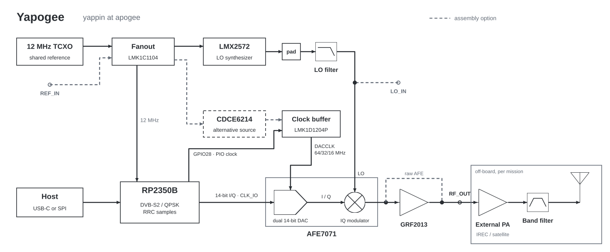

# Yapogee

Welcome, welcome, welcome! I went looking for a small, affordable QPSK transmitter and couldn't find what I wanted. So we're making one. Meet Yapogee: a little USB-C/SPI board that is ready to yap.

The plan: RP2350B handles DVB-S2 encoding and, through the power of PIO, sends I/Q samples to an AFE7071. A shared reference, LMX2572 LO and optional small driver get us to RF. IREC at 1.24–1.30 GHz comes first; 2.4 GHz satellite work reuses the core with a different external PA and filter.

Dashed lines are assembly options. PIO also supplies the DAC clock through a differential driver; that interface still needs verification. The [dev-board diagrams](hardware/devboard/architecture/architecture.drawio) show RF, clocks and power separately.

For N samples per symbol, `f_IQ = N × R_s` and the interleaved bus runs at `f_bus = 2 × f_IQ`. At 8 Msym/s with N=4, that's 32 MS/s per I/Q channel and 64 Mwords/s on the bus. The proposed continuous PIO clock is `f_SYS / (2 × divider)`: 128 MHz / 2 = 64 MHz.

| Area | Contents |
|---|---|
| [Hardware](hardware/README.md) | Initial dev board, future transmitter board and hardware models |
| [Software](software/README.md) | Data path, timing, reference models and future cleaned firmware |

Schematic capture is underway in [KiCad](hardware/devboard/board/Yapogee-Devboard/Yapogee-Devboard.kicad_pro), with a local [component library](hardware/libraries/README.md). Firmware will come from a cleaned import of the [digital benchmark](https://github.com/Rivercraft911/RP2350_IQ_Benchmark). The RF board hasn't been built yet.
