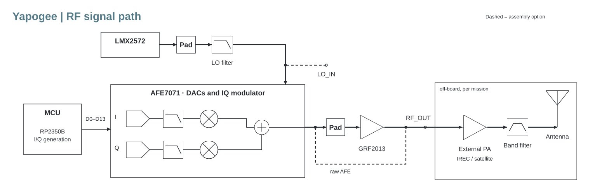

# Initial development board

RP2350B makes I/Q samples; AFE7071 turns them into RF using the LMX2572 LO. A shared 12 MHz reference ties the timing together. GRF2013 adds optional low-power drive, with the mission PA and band filter outside the board. IREC at 1.24–1.30 GHz comes first; the core also covers 2.4 GHz.



[Editable diagrams](architecture/architecture.drawio) · [Clocks](architecture/reference-clocks.svg) · [Power tree](architecture/power-interfaces.svg)

## Parts

| Function | Current device |
|---|---|
| MCU / flash | RP2350B A4 (SC1510-A4), W25Q128JVSIQ; [RP2350 hardware guide](https://datasheets.raspberrypi.com/rp2350/hardware-design-with-rp2350.pdf) |
| Reference / fanout | ECS-TXO-2520MV-120-AN-TR, LMK1C1104PWR |
| DAC / IQ modulator | [AFE7071IRGZT](https://www.ti.com/product/AFE7071) |
| LO | [LMX2572RHAT](https://www.ti.com/lit/ds/symlink/lmx2572.pdf) |
| DAC clock | GPIO28 continuous PIO; LMK1D1204PRHDT driver remains conditional |
| RF driver | GRF2013, optional |
| Input | GCT USB4105-GF-A-060, TPS259470ARPWR eFuse |
| Buck | TPS62441QWRQRRQ1: DIG3V3 and PRE2V5 |
| Quiet supplies | TPS7A8801QRTJRQ1: AFE3V3 / AFE1V8; 2×TPS7A2133PQWDRBRQ1: LO3V3 / REF3V3 |
| Reset / watchdog | TPS386000RGPT; RGPR is the same package with a different reel quantity |
| Driver supply | TPS22918DBVR load switch |

These are the working parts, not a released BOM. The [KiCad project](board/Yapogee-Devboard/Yapogee-Devboard.kicad_pro) loads the local [symbols, footprints and models](../libraries/README.md). Capture is underway; layout and hardware testing are still ahead.

## How it fits together

**Power:** USB-C or EXT_5V → eFuse → protected 5 V. The dual buck makes DIG3V3 and PRE2V5; PRE2V5 feeds the AFE's 1.8 V LDO. The three quiet 3.3 V outputs come from protected 5 V. TPS386000 handles reset and watchdog recovery; AFE LDO power-good gives coarse fault detection. Rail test points and the eFuse current signal support bring-up.

Use a verified 5 V / 3 A source for this eval board. Each CC pin has a 5.1 kΩ pull-down; available USB current is not detected. A removable solder bridge disconnects USB VBUS when EXT_5V powers the board.

**MCU:** SPI carries payload data; USB handles programming and test access. SWD, BOOTSEL, RUN, LEDs and isolated DNP I/Q header positions make the first board easy to probe. Host pin assignments are still open.

**LO and clocks:** the 12 MHz reference feeds the MCU and synthesizer. At SYS128 MHz, PIO supplies a continuous 64/32/16 MHz DAC clock for 32/16/8 MS/s per I/Q channel. External reference and LO injection use assembly links. An LO pad and low-pass filter set drive and suppress harmonics before the AFE. The differential DAC-clock interface still needs verification.

**IQ and RF:** assembly links select raw AFE output or the GRF2013 driver. Populate one top-mounted SMA first; the compact external-LO connector stays DNP. Leave space for a removable shield. A component-free underside helps the future solder-down carrier interface; its pad pattern is still open.

## Models

Run from the repo root with Python 3:

```sh
python3 hardware/simulations/link_budget.py
python3 hardware/simulations/reference_lo_loop_screen.py
python3 hardware/simulations/dac_clock_budget.py
```

The link model writes tables and JSON to `hardware/simulations/output/`; the other two print JSON. Their assumptions are in the source. They don't establish measured RF performance or loaded clock timing.
